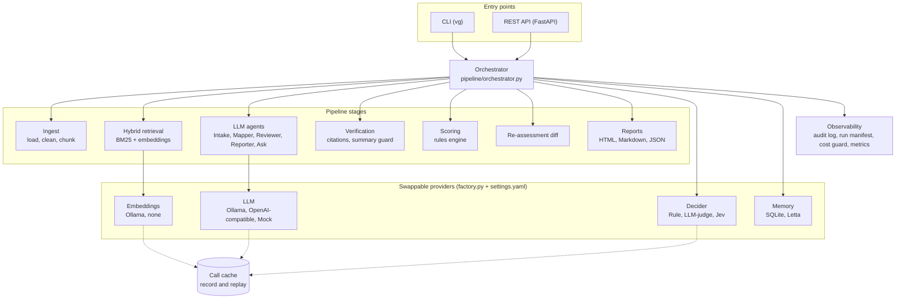
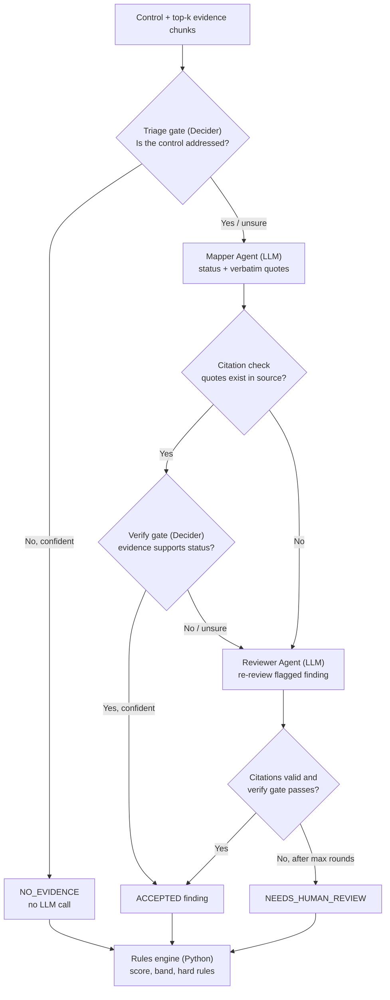
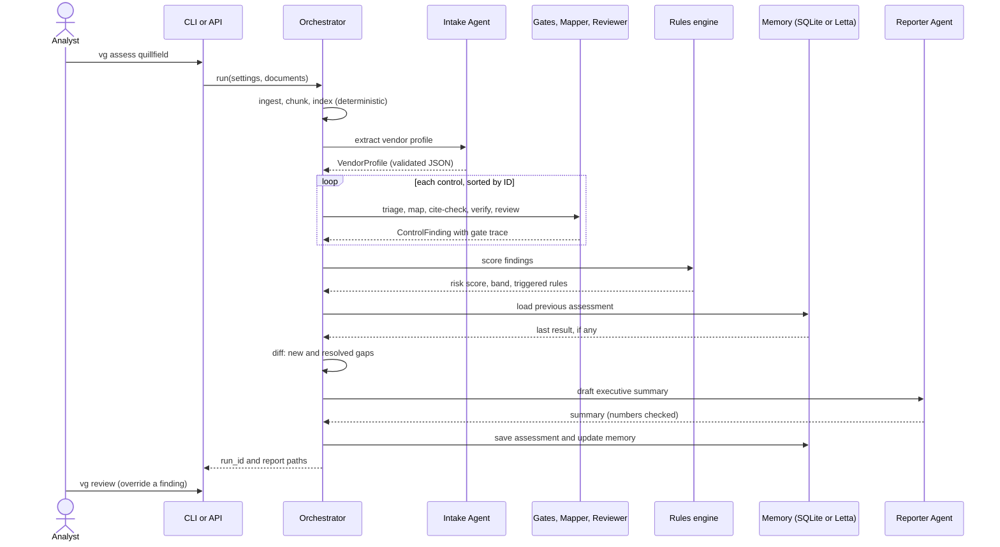

<h1 align="center">VendorGuard AI</h1>

<p align="center">
  <b>Multi-agent, evidence-cited third-party security risk assessment that runs at $0 by default.</b>
</p>

<p align="center">
  <a href="https://github.com/himanshugoel9725/vendorguard-ai/actions/workflows/ci.yml"></a>
  
  
  
</p>

> 🚧 **Status: in active development.** Progress is tracked in [docs/PROGRESS.md](docs/PROGRESS.md) and the
> build plan is in [docs/PLAN.md](docs/PLAN.md). Commands below describe the target v1.0 behaviour.

---

## Contents

- [Why VendorGuard?](#why-vendorguard)
- [What it does](#what-it-does)
- [How it works](#how-it-works)
- [The agents](#the-agents)
- [Decision layer: rule, LLM-judge or Jev](#decision-layer-rule-llm-judge-or-jev)
- [Deterministic by design](#deterministic-by-design)
- [Cost model](#cost-model)
- [Tech stack](#tech-stack)
- [Quickstart](#quickstart)
- [Configuration](#configuration)
- [CLI](#cli)
- [REST API](#rest-api)
- [Project structure](#project-structure)
- [Evaluation](#evaluation)
- [Testing and CI/CD](#testing-and-cicd)
- [Security](#security)
- [Roadmap](#roadmap)
- [Limitations](#limitations)
- [License](#license)

---

## Why VendorGuard?

Organisations depend on hundreds of vendors: SaaS tools, cloud platforms, payroll providers, logistics
partners. Each one must be assessed for security risk before onboarding and again every year. Today an
analyst reads 50–200 pages of policies, trust-centre whitepapers and audit-report excerpts, maps them by hand
to a control framework and writes up findings. This is slow, expensive and inconsistent from one analyst to
the next.

**VendorGuard AI does the first pass automatically and shows its work.** Every finding is tied to a verbatim,
page-referenced quote that the system has verified exists in the source document. Every decision is logged.
Scores come from transparent, configurable rules rather than an LLM's opinion, and the analyst always has the
final word.

## What it does

- 📄 **Ingests** vendor documents (PDF, TXT, Markdown) with page-aware chunking
- 🧭 **Maps evidence** to 25 baseline controls, each mapped to ISO/IEC 27001:2022 and NIST CSF 2.0
- 🔎 **Verifies every citation** against the source text, so evidence cannot be hallucinated
- ⚖️ **Decision gates** decide when a finding can be trusted, when it needs a second look, and when a human must decide
- 📊 **Scores residual risk** with a rules engine whose weights and thresholds live in one config file
- 🧠 **Remembers each vendor** (SQLite, or Letta stateful agents) and shows what changed since the last assessment
- 🙋 **Human in the loop:** analysts accept or override any finding, and the reason is recorded
- 🧾 **Audit trail** and reproducible run manifests for every assessment
- 💸 **$0 by default:** local models through Ollama; paid services are optional and protected by budget guards

## How it works

### System architecture



### The per-control decision cascade

Each of the 25 controls goes through the same cascade. LLMs propose; decision gates and deterministic checks
decide whether to trust the proposal.



### One assessment run



## The agents

| Agent | Job | Output | Model calls |
|---|---|---|---|
| **Intake** | Extract vendor facts: services, data handled, hosting, certifications, subprocessors | `VendorProfile` | 1 per run |
| **Mapper** | Decide a control's status and quote the supporting evidence | `DraftFinding` | ≤ 1 per control |
| **Reviewer** | Re-examine findings flagged by the gates, with extra evidence | revised `DraftFinding` | only when flagged |
| **Reporter** | Write a short executive summary from the structured result only | summary text | 1 per run |
| **Ask** | Answer questions about a vendor's history, citing run and control IDs | `Answer` | per question |
| **Decider** (gates) | Triage and verify decisions on one control at a time | `Decision` (label + confidence) | rule = none |

Deterministic tools do the rest: ingestion, retrieval, citation checking, inherent-risk rules, scoring,
diffing and report rendering.

## Decision layer: rule, LLM-judge or Jev

The two gates use a pluggable **decider**, chosen with one line in `config/settings.yaml`:

| Decider | Cost | Determinism | When to use |
|---|---|---|---|
| `rule` (default) | $0 | fully deterministic | development, CI, a transparent baseline |
| `llm_judge` | $0 with Ollama | temperature 0, fixed seed, cached | offline alternative ("LLM-as-a-judge") |
| `jev` | about $0.004 per vendor (estimate) | cached, configurable thresholds | a fast, bounded decision model for the gates |
| `mock` | $0 | deterministic | tests |

Jev is a "System 1" decision model that returns a label with a probability instead of generating text.
VendorGuard follows the *generate, then decide* pattern described in the
[Jev-LiteMAS paper](https://arxiv.org/pdf/2610.21411): LLMs generate, the decider screens the outputs, and
only flagged items go back to an LLM. Jev is used only for
single-control questions; vendor-level aggregation stays in the Python rules engine. If Jev is unavailable,
the system falls back to the `rule` decider automatically and records that in the audit log.

## Deterministic by design

| Level | Mechanism | Guarantee |
|---|---|---|
| L0 | Rules engine, citation checks, diff, rendering, stable sorting and IDs | identical every time |
| L1 | Record/replay cache keyed by provider, model, prompt version, inputs and parameters | identical re-runs; offline CI |
| L2 | Temperature 0, fixed seed, JSON-schema output, Pydantic validation | near-identical on the same model and machine |
| L3 | Run manifest: config fingerprint, prompt hashes, model IDs, input hashes, result hash | every result reproducible and auditable |

## Cost model

| Mode | LLM | Decider | Memory | Estimated cost per vendor |
|---|---|---|---|---|
| Default | Ollama (local) | rule | SQLite | **$0** |
| Offline alternative | Ollama | llm_judge | SQLite | $0 |
| Decision model | Ollama | jev | SQLite | under $0.01 |
| Memory agent | Ollama | any | Letta self-hosted | $0 |
| Showcase | Ollama | jev | Letta Cloud | Letta credits for questions only, capped per day |
| CI and demo site | mock / replay | rule / replay | SQLite | $0 |

Hard limits (`cost.max_usd_per_run`, `cost.max_llm_calls_per_run`,
`memory.letta.cloud_max_messages_per_day`) stop a run before it overspends.

## Tech stack

| Area | Choice |
|---|---|
| Language and tooling | Python 3.12, uv, ruff, mypy, pytest, pre-commit |
| Local LLM and embeddings | Ollama (`qwen2.5`, `nomic-embed-text`); no Hugging Face |
| Retrieval | BM25 (`rank-bm25`) + cosine similarity (numpy), hybrid ranking |
| Agents and memory | Custom deterministic orchestrator; Letta stateful agents (optional) |
| Decision model | Rule engine, LLM-judge, or Jev (optional) |
| Data contracts | Pydantic v2 |
| PDF | pypdf (read), fpdf2 (synthetic sample generation) |
| API | FastAPI, Uvicorn, Prometheus metrics |
| Reports | Jinja2 (self-contained HTML, Markdown, JSON) |
| CI/CD | GitHub Actions, GitHub Pages (docs and demo reports), GHCR Docker images |
| Docs | MkDocs Material |

## Quickstart

**Prerequisites:** macOS or Linux, [uv](https://docs.astral.sh/uv/), [Ollama](https://ollama.com) and git.
Docker is only needed for self-hosted Letta.

```bash
git clone https://github.com/himanshugoel9725/vendorguard-ai.git && cd vendorguard-ai
```

```bash
make setup
```

```bash
ollama pull qwen2.5:7b && ollama pull nomic-embed-text
```

```bash
cp .env.example .env
```

```bash
uv run vg doctor
```

```bash
make sample
```

```bash
uv run vg assess --vendor quillfield --docs data/samples/quillfield.pdf
```

The command prints a `run_id` and the report paths under `data/runs/<run_id>/`. Open the HTML report:

```bash
uv run vg report <run_id> --format html --open
```

**No Ollama yet?** Run everything with the deterministic keyword baseline:

```bash
VG_LLM__PROVIDER=mock VG_EMBEDDINGS__PROVIDER=none uv run vg assess --vendor quillfield --docs data/samples/quillfield.pdf
```

## Configuration

- **One file for every parameter:** [`config/settings.yaml`](config/settings.yaml), with comments on each value.
- **Secrets only in `.env`:** copy [`.env.example`](.env.example). The default setup needs no keys.
- **Override anything** with environment variables named `VG_<SECTION>__<KEY>`:

```bash
VG_LLM__MODEL=qwen2.5:3b VG_DECISION__PROVIDER=llm_judge uv run vg assess --vendor brightdock --docs data/samples/brightdock.pdf
```

Swapping an implementation is one line:

```yaml
llm:      {provider: openai_compat}   # Gemini / Groq / OpenAI / OpenRouter instead of Ollama
decision: {provider: jev}             # Jev decision model for the gates
memory:   {provider: letta}           # Letta memory agent per vendor
```

**Swappable providers**

| Kind | Implementations | Config key |
|---|---|---|
| LLM | `ollama`, `openai_compat`, `mock` | `llm.provider` |
| Embeddings | `ollama`, `none` | `embeddings.provider` |
| Decider | `rule`, `llm_judge`, `jev`, `mock` | `decision.provider` |
| Memory | `sqlite`, `letta` (self-hosted or cloud) | `memory.provider` |
| Cache | `sqlite`, `jsonl` | `cache.backend` |

## CLI

| Command | What it does |
|---|---|
| `vg doctor` | Checks config, provider reachability and keys (shown only as set/unset) |
| `vg samples` | Generates the synthetic sample vendors |
| `vg assess --vendor ID --docs FILE...` | Runs an assessment |
| `vg runs list` / `vg runs show RUN_ID` | Past runs and their audit timelines |
| `vg report RUN_ID --format html --open` | Renders or opens a report |
| `vg review RUN_ID CONTROL_ID --status met --reason "..."` | Analyst override |
| `vg vendors list` / `vg vendors history ID` | Vendor memory and assessment diffs |
| `vg ask ID "What changed since last year?"` | Questions about a vendor's history |
| `vg eval` | Runs the evaluation matrix |

## REST API

Interactive docs at `http://127.0.0.1:8000/docs` after `make api`. All `/v1` routes need the `X-API-Key` header.

| Method | Route | Purpose |
|---|---|---|
| `GET` | `/health`, `/version`, `/metrics` | liveness, version, Prometheus metrics |
| `POST` | `/v1/assessments` | upload documents and start an assessment (returns `run_id`) |
| `GET` | `/v1/assessments/{run_id}` | status and result |
| `GET` | `/v1/assessments/{run_id}/report?format=html\|md\|json` | report |
| `PATCH` | `/v1/assessments/{run_id}/findings/{control_id}` | analyst override |
| `GET` | `/v1/vendors`, `/v1/vendors/{id}/history` | vendor memory |
| `POST` | `/v1/vendors/{id}/ask` | question about a vendor |

## Project structure

```text
config/settings.yaml          the one parameter file
config/controls/              control set (25 controls mapped to ISO 27001 / NIST CSF 2.0)
prompts/                      versioned prompt templates
src/vendorguard/
  interfaces/                 Protocols: the swappable parts
  models/                     Pydantic data contracts
  ingest/  retrieval/         deterministic document processing and search
  providers/                  llm/ embed/ decide/ memory/ cache/ implementations
  agents/                     small LLM workers
  verification/  scoring/     citation checks, summary guard, rules engine
  diff/  reporting/           re-assessment diff, HTML/MD/JSON reports
  observability/              audit log, run manifest, cost guard, metrics
  pipeline/orchestrator.py    the one module that wires everything together
  cli/  api/                  entry points
data/samples/                 synthetic vendors (fictional) + golden labels in data/golden/
docs/                         plan, progress, decisions, configuration, evaluation
```

## Evaluation

Evaluation runs on 4 synthetic sample vendors (25 controls each) whose true control statuses are known by
construction. The results do not transfer to real vendor documents. All real-model runs use one small model
(`qwen2.5:3b`, CPU-only Intel Mac); no hosted LLM was measured.

| Config | Decider | Accuracy | Macro-F1 | Human review | LLM calls | Cost USD |
|---|---|---|---|---|---|---|
| `ollama-jev` | Jev | 0.52 | 0.59 | 14 % | 113 | 0.0061 |
| `ollama-rule-bm25` | rule | 0.40 | 0.40 | 0 % | 95 | 0 |
| `ollama-rule` | rule | 0.35 | 0.30 | 1 % | 110 | 0 |
| `ollama-judge` | LLM judge | 0.17 | 0.08 | 1 % | 116 | 0 |

- `keyword-baseline` (mock LLM) scores 1.00 only because it matches the generator's vocabulary. It checks the
  pipeline and is not a model result.
- Most errors are a false `no_evidence`: the 3B model often returns no quote. The weak LLM-judge result is a
  limit of this small model, not a verdict on LLM judges.
- Jev scores best; 14 % of its controls go to a person. The cause of its lead was not isolated. It is a
  hosted, paid, alpha-stage service, and this is one small sample.
- Real-model runs were not repeatable here: with the cache off, two identical runs (only two repeats, the first
  possibly a cold start) gave 0 % identical result hashes and 52 % identical findings. Replaying the committed cassettes is 100 % identical.

Method, per-vendor tables, charts, determinism and how to reproduce:
[docs/EVALUATION.md](docs/EVALUATION.md).

## Testing and CI/CD

- `make check` runs ruff, mypy (strict) and pytest offline with mock providers. Coverage gate: 80 %.
- **Replay tests** run the real pipeline against recorded model outputs (`tests/cassettes/`), so CI needs no
  model server and costs nothing.
- **GitHub Actions:** lint, type-check, tests, determinism test, secret scan (gitleaks) and a guard that fails
  the build if any Hugging Face package or model appears.
- **GitHub Pages:** documentation plus demo reports generated in replay mode on every push to `main`.
- **Releases:** tagging `v*` builds and publishes a Docker image to GitHub Container Registry.

## Security

- Secrets live only in `.env` / environment variables, are handled as `SecretStr` and redacted from logs.
- Vendor documents are treated as untrusted input: they are delimited in prompts, instructions inside them
  are ignored, and every quote is checked against the source. A sample vendor contains a prompt-injection
  paragraph as a regression test.
- The API uses an API key with constant-time comparison, upload type and size checks, filename sanitising,
  rate limiting and configurable CORS.
- Dependencies are pinned in `uv.lock` and monitored by Dependabot.

## Roadmap

- [ ] v1.0: CLI, API, reports, memory, decision gates, evaluation, CI/CD, docs site
- [ ] Optional UI (Streamlit, then React)
- [ ] OCR for scanned PDFs
- [ ] More control sets (for example a cloud-specific or privacy-specific set)
- [ ] Questionnaire auto-fill (SIG-style or CAIQ-style answers from vendor evidence)
- [ ] OpenTelemetry tracing

## Limitations

- VendorGuard produces a **first-pass assessment to support analysts**. It does not replace professional
  judgement, audits or the official standards.
- Control mappings to ISO/IEC 27001:2022 and NIST CSF 2.0 are indicative.
- Bundled sample vendors (Nimbara HR, Quillfield Analytics, Brightdock Freight) are **fictional**, and
  accuracy figures measured on them may not transfer to real documents.
- Scanned (image-only) PDFs are not supported yet.

## License

[MIT](LICENSE)
