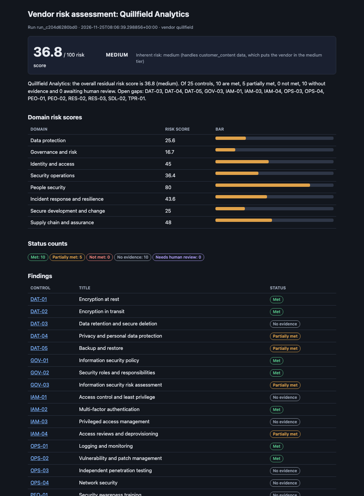
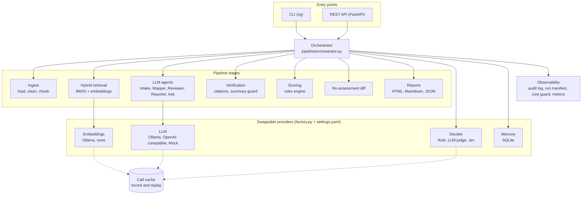
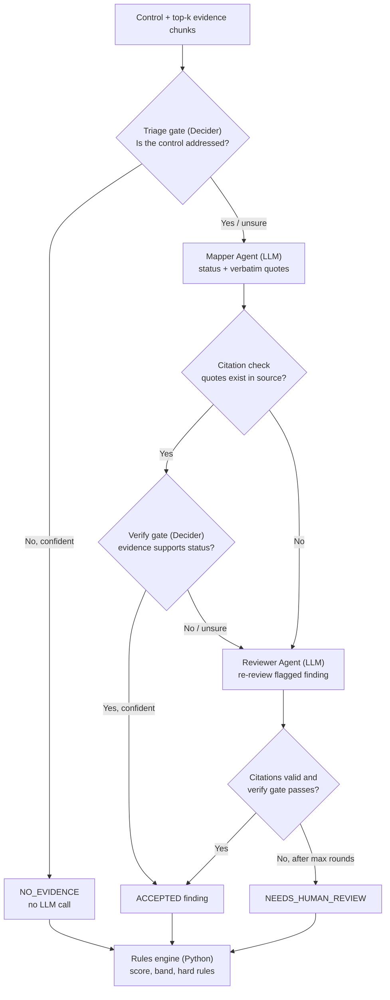
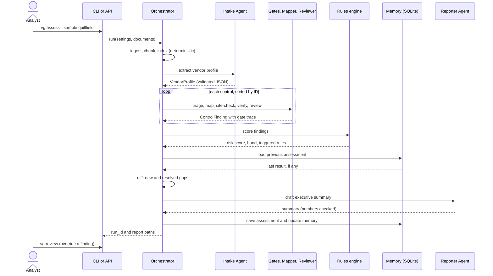

<h1 align="center">VendorGuard AI</h1>

<p align="center">
  <b>Multi-agent, evidence-cited third-party security risk assessment that runs at $0 by default.</b>
</p>

<p align="center">
  <a href="https://github.com/himanshugoel9725/vendorguard-ai/actions/workflows/ci.yml"></a>
  <a href="https://github.com/himanshugoel9725/vendorguard-ai/actions/workflows/pages.yml"></a>
  
  
  
</p>

<p align="center">
  <a href="https://himanshugoel9725.github.io/vendorguard-ai/">Documentation</a> |
  <a href="https://himanshugoel9725.github.io/vendorguard-ai/demo/">Demo reports</a> |
  <a href="https://himanshugoel9725.github.io/vendorguard-ai/EVALUATION/">Evaluation</a>
</p>

**Status.** Working today: the CLI, the REST API, HTML/Markdown/JSON reports, vendor memory with SQLite and the
re-assessment diff, the evaluation harness, the documentation site, CI and a release workflow. Not there yet:

- Letta memory is not implemented (optional, deferred in ADR-019); only SQLite memory exists.
- The optional UI (Phase 12) is not built.
- The Docker image was built and smoke-tested only on a CI runner; `docker compose up` and Docker Desktop on
  macOS were not tried.
- No version tag or GitHub Release has been published, and no image has been pushed to a registry.

Build notes: [docs/PROGRESS.md](docs/PROGRESS.md) and [docs/PLAN.md](docs/PLAN.md).

---

## Contents

- [Why VendorGuard?](#why-vendorguard)
- [What it does](#what-it-does)
- [Demo](#demo)
- [How it works](#how-it-works)
- [The agents](#the-agents)
- [Decision layer: rule, LLM-judge or Jev](#decision-layer-rule-llm-judge-or-jev)
- [Deterministic by design](#deterministic-by-design)
- [Cost model](#cost-model)
- [Tech stack](#tech-stack)
- [Quickstart](#quickstart)
- [Configuration](#configuration)
- [CLI](#cli)
- [REST API](#rest-api)
- [Project structure](#project-structure)
- [Evaluation](#evaluation)
- [Testing and CI/CD](#testing-and-cicd)
- [Security](#security)
- [Roadmap](#roadmap)
- [Limitations](#limitations)
- [License](#license)

---

## Why VendorGuard?

Organisations depend on hundreds of vendors: SaaS tools, cloud platforms, payroll providers, logistics
partners. Each one must be assessed for security risk before onboarding and again every year. Today an
analyst reads 50–200 pages of policies, trust-centre whitepapers and audit-report excerpts, maps them by hand
to a control framework and writes up findings. This is slow, expensive and inconsistent from one analyst to
the next.

**VendorGuard AI does the first pass automatically and shows its work.** Every finding is tied to a verbatim,
page-referenced quote that the system has verified exists in the source document. Every decision is logged.
Scores come from transparent, configurable rules rather than an LLM's opinion, and the analyst always has the
final word.

## What it does

- 📄 **Ingests** vendor documents (PDF, TXT, Markdown) with page-aware chunking
- 🧭 **Maps evidence** to 25 baseline controls, each mapped to ISO/IEC 27001:2022 and NIST CSF 2.0
- 🔎 **Verifies every citation** against the source text, so evidence cannot be hallucinated
- ⚖️ **Decision gates** decide when a finding can be trusted, when it needs a second look, and when a human must decide
- 📊 **Scores residual risk** with a rules engine whose weights and thresholds live in one config file
- 🧠 **Remembers each vendor** (SQLite) and shows what changed since the last assessment
- 🙋 **Human in the loop:** analysts accept or override any finding, and the reason is recorded
- 🧾 **Audit trail** and reproducible run manifests for every assessment
- 💸 **$0 by default:** local models through Ollama; paid services are optional and protected by budget guards

## Demo

<p align="center">
  
</p>

*The HTML report for Quillfield Analytics, a **synthetic** (fictional) vendor. It is a replay of a recorded run
of a small local model (`qwen2.5:3b`), so its findings are not facts about any real company.*

- [Live demo reports](https://himanshugoel9725.github.io/vendorguard-ai/demo/): four synthetic vendors, replayed offline from recorded model outputs.
- [Documentation site](https://himanshugoel9725.github.io/vendorguard-ai/): architecture, CLI, API, configuration, evaluation.

## How it works

### System architecture



### The per-control decision cascade

Each of the 25 controls goes through the same cascade. LLMs propose; decision gates and deterministic checks
decide whether to trust the proposal.



### One assessment run



## The agents

| Agent | Job | Output | Model calls |
|---|---|---|---|
| **Intake** | Extract vendor facts: services, data handled, hosting, certifications, subprocessors | `VendorProfile` | 1 per run |
| **Mapper** | Decide a control's status and quote the supporting evidence | `DraftFinding` | ≤ 1 per control |
| **Reviewer** | Re-examine findings flagged by the gates, with extra evidence | revised `DraftFinding` | only when flagged |
| **Reporter** | Write a short executive summary from the structured result only | summary text | 1 per run |
| **Ask** | Answer questions about a vendor's history, citing run and control IDs | `Answer` | per question |
| **Decider** (gates) | Triage and verify decisions on one control at a time | `Decision` (label + confidence) | rule = none |

Deterministic tools do the rest: ingestion, retrieval, citation checking, inherent-risk rules, scoring,
diffing and report rendering.

## Decision layer: rule, LLM-judge or Jev

The two gates use a pluggable **decider**, chosen with one line in `config/settings.yaml`:

| Decider | Cost | Determinism | When to use |
|---|---|---|---|
| `rule` (default) | $0 | fully deterministic | development, CI, a transparent baseline |
| `llm_judge` | $0 with Ollama | temperature 0, fixed seed, cached | offline alternative ("LLM-as-a-judge") |
| `jev` | paid: $0.0061 for the whole 4-vendor evaluation (198 calls) | cached, configurable thresholds | a hosted decision model for the gates (alpha-stage service) |
| `mock` | $0 | deterministic | tests |

Jev is a "System 1" decision model that returns a label with a probability instead of generating text. By
default VendorGuard AI reaches it through the TypeSafe System One API (`decision.jev.base_url`, model pinned to
`jev-1.14.0`; ADR-016, ADR-020); it needs `VG_DECISION__JEV__API_KEY` in `.env`. OpenRouter works through three
setting overrides (see the comment in `config/settings.yaml`).
VendorGuard follows the *generate, then decide* pattern described in the
[Jev-LiteMAS paper](https://arxiv.org/pdf/2610.21411): LLMs generate, the decider screens the outputs, and
only flagged items go back to an LLM. Jev is used only for
single-control questions; vendor-level aggregation stays in the Python rules engine. If Jev is unavailable,
the system falls back to the `rule` decider automatically and records that in the audit log.

## Deterministic by design

Determinism comes from five things: temperature 0 and a fixed seed, JSON-schema output validated by Pydantic,
a record/replay cache, canonical hashes (the run manifest), and Python (not the model) making the decisions:
flow, scoring, sorting and citation checks.

| Level | Mechanism | What it gives |
|---|---|---|
| L0 | Rules engine, citation checks, diff, rendering, stable sorting and IDs | identical every time |
| L1 | Record/replay cache keyed by provider, model, rendered prompt, inputs and parameters | identical re-runs; offline CI |
| L2 | Temperature 0, fixed seed, JSON-schema output, Pydantic validation | reduces variation; no guarantee |
| L3 | Run manifest: config fingerprint, prompt hashes, model IDs, input hashes, result hash | results can be compared and audited |

**Replay is exactly repeatable. Live model runs were not.** In our measurement (two repeats, cache off,
`qwen2.5:3b`, synthetic samples) 0 % of result hashes and 52 % of findings were identical, even at temperature 0
with a seed. Replaying the committed cassettes gives identical results (tested). Details and caveats:
[Evaluation](https://himanshugoel9725.github.io/vendorguard-ai/EVALUATION/).

## Cost model

| Mode | LLM | Decider | Memory | Cost |
|---|---|---|---|---|
| Default | Ollama (local) | rule | SQLite | **$0** |
| Offline alternative | Ollama | llm_judge | SQLite | $0 |
| Decision model | Ollama | jev | SQLite | Jev only: $0.042 per million input tokens, output free; $0.0061 for the 4-vendor evaluation |
| Hosted LLM | OpenAI, Groq or OpenAI-compatible | any | SQLite | provider price, set in `cost.prices_per_million_tokens`; not measured here |
| CI and demo site | mock / replay | rule | SQLite | $0 |

Hard limits (`cost.max_usd_per_run`, `cost.max_llm_calls_per_run`) stop a run before it overspends. Tests and
CI never call a paid service.

## Tech stack

| Area | Choice |
|---|---|
| Language and tooling | Python 3.12, uv, ruff, mypy, pytest, pre-commit |
| Local LLM and embeddings | Ollama (`qwen2.5`, `nomic-embed-text`); no Hugging Face |
| Retrieval | BM25 (`rank-bm25`) + cosine similarity (numpy), hybrid ranking |
| Agents and memory | Custom deterministic orchestrator; SQLite memory (Letta is not implemented) |
| Decision model | Rule engine, LLM-judge, or Jev (optional, paid) |
| Data contracts | Pydantic v2 |
| PDF | pypdf (read), fpdf2 (synthetic sample generation) |
| CLI and API | Typer, FastAPI, Uvicorn, Prometheus metrics |
| Reports | Jinja2 (self-contained HTML, Markdown, JSON) |
| CI/CD | GitHub Actions, GitHub Pages (docs and demo reports), release workflow for a GHCR image (not yet run on a tag) |
| Docs | MkDocs Material |

## Quickstart

**Prerequisites:** macOS or Linux, [uv](https://docs.astral.sh/uv/), [Ollama](https://ollama.com) and git.
Docker is optional (only for the API container).

```bash
git clone https://github.com/himanshugoel9725/vendorguard-ai.git && cd vendorguard-ai
```

```bash
make setup
```

```bash
ollama pull qwen2.5:3b && ollama pull nomic-embed-text
```

```bash
cp .env.example .env
```

```bash
uv run vg doctor
```

```bash
make sample
```

```bash
uv run vg assess --vendor quillfield --docs data/samples/quillfield.pdf
```

The command prints a `run_id` and the report paths under `data/runs/<run_id>/`. On a CPU-only machine a small
local model needs minutes per vendor (one recorded `qwen2.5:3b` run took about 7 minutes). Open the HTML report:

```bash
uv run vg report <run_id> --format html --open
```

**No Ollama yet?** Run everything with the deterministic keyword baseline:

```bash
VG_LLM__PROVIDER=mock VG_EMBEDDINGS__PROVIDER=none uv run vg assess --vendor quillfield --docs data/samples/quillfield.pdf
```

## Configuration

- **One file for every parameter:** [`config/settings.yaml`](config/settings.yaml), with comments on each value. Every setting is also listed in the [generated configuration reference](https://himanshugoel9725.github.io/vendorguard-ai/CONFIG/) (`make docs-config` regenerates it).
- **Secrets only in `.env`:** copy [`.env.example`](.env.example). The default setup needs no keys.
- **Override anything** with environment variables named `VG_<SECTION>__<KEY>`:

```bash
VG_LLM__MODEL=qwen2.5:3b VG_DECISION__PROVIDER=llm_judge uv run vg assess --vendor brightdock --docs data/samples/brightdock.pdf
```

Swapping an implementation is one line:

```yaml
llm:      {provider: openai_compat}   # or openai / groq: a hosted model instead of Ollama
decision: {provider: jev}             # Jev decision model for the gates
```

**Swappable providers**

| Kind | Implementations | Config key |
|---|---|---|
| LLM | `ollama`, `openai`, `groq`, `openai_compat`, `mock` | `llm.provider` |
| Embeddings | `ollama`, `none` | `embeddings.provider` |
| Decider | `rule`, `llm_judge`, `jev`, `mock` | `decision.provider` |
| Memory | `sqlite` (`letta` is accepted by the config but not implemented) | `memory.provider` |
| Cache | `sqlite`, `jsonl` | `cache.backend` |

## CLI

Run as `uv run vg ...`; `uv run vg --help` lists everything. Full reference:
[CLI page](https://himanshugoel9725.github.io/vendorguard-ai/cli/).

| Command | What it does |
|---|---|
| `vg doctor` | Checks config, provider reachability and keys (shown only as set/unset) |
| `vg samples` | Lists the synthetic sample vendors (`make sample` creates them) |
| `vg assess --vendor ID --docs FILE...` or `vg assess --sample STEM` | Runs an assessment (options: `--llm`, `--decider`, `--embeddings`, `--controls`, `--cache`) |
| `vg runs list` / `vg runs show RUN_ID` | Past runs and the findings of one run |
| `vg report RUN_ID --format html --open` | Rewrites or opens a report (`json`, `md`, `html`) |
| `vg review RUN_ID CONTROL_ID --status met --reason "..." --analyst NAME` | Analyst override |
| `vg vendors list` / `vg vendors history ID` | Vendor memory and run history |
| `vg ask ID "What changed since last year?"` | Questions about a vendor's history |
| `vg eval [--configs a,b]` | Runs the evaluation matrix |
| `vg determinism [--config NAME]` | Repeats one config with the cache off and counts identical results |
| `vg charts` | Draws the evaluation charts from `docs/evaluation/results.json` |

Useful `make` targets: `make check` (lint, types, tests), `make sample`, `make eval`, `make record`
(re-record replay cassettes with local Ollama), `make api`, `make docs` (strict MkDocs build),
`make docs-config`, `make demo-memory` (offline year 1 / year 2 / diff / ask demo).

## REST API

Start it with `make api`; interactive docs are at `http://127.0.0.1:8000/docs`. Set `VG_API__AUTH_KEY` (at least
16 characters) in `.env` first: the API refuses to start without it, unless auth is off and the host is loopback.
`/health` is open; every other route needs the `X-API-Key` header. Full reference:
[REST API page](https://himanshugoel9725.github.io/vendorguard-ai/api/).

| Method | Route | Purpose |
|---|---|---|
| `GET` | `/health` (open), `/version`, `/metrics` | liveness, version, Prometheus metrics |
| `POST` | `/v1/assessments` | upload documents and start an assessment (returns `run_id`) |
| `GET` | `/v1/assessments/{run_id}` | status and result |
| `GET` | `/v1/assessments/{run_id}/report?format=html\|md\|json` | report |
| `PATCH` | `/v1/assessments/{run_id}/findings/{control_id}` | analyst override |
| `GET` | `/v1/vendors`, `/v1/vendors/{id}/history` | vendor memory |
| `POST` | `/v1/vendors/{id}/ask` | question about a vendor |

Defaults: 30 requests per minute per key, 20 MB per file, 5 files per request, 64 KB JSON bodies, 5 queued
assessments (one runs at a time). Limits are in the `api` section of `config/settings.yaml`.

## Project structure

```text
config/settings.yaml          the one parameter file
config/controls/              control set (25 controls mapped to ISO 27001 / NIST CSF 2.0)
prompts/                      versioned prompt templates
src/vendorguard/
  interfaces/                 Protocols: the swappable parts
  models/                     Pydantic data contracts
  ingest/  retrieval/         deterministic document processing and search
  providers/                  llm/ embed/ decide/ memory/ cache/ implementations (memory: SQLite only)
  agents/                     small LLM workers
  verification/  scoring/     citation checks, summary guard, rules engine
  diff/  reporting/           re-assessment diff, HTML/MD/JSON reports
  observability/              audit log, run manifest, cost guard, metrics
  pipeline/                   orchestrator.py wires everything together
  eval/                       sample generator, metrics, eval runner, charts
  cli/  api/                  entry points
data/samples/                 synthetic vendors (fictional) + specs; golden labels in data/golden/
tests/                        unit, integration, replay cassettes (tests/cassettes/), live tests (skipped by default)
scripts/                      sample generator, config docs generator, demo builder, checks
docs/                         MkDocs site sources, plan, progress, decisions, evaluation results
Dockerfile  docker-compose.yml  API image (compose profile `api`)
.github/workflows/            ci.yml, pages.yml, release.yml
```

## Evaluation

Evaluation runs on 4 synthetic sample vendors (25 controls each) whose true control statuses are known by
construction. The results do not transfer to real vendor documents. All real-model runs use one small model
(`qwen2.5:3b`, CPU-only Intel Mac); no hosted LLM was measured.

| Config | Decider | Accuracy | Macro-F1 | Human review | LLM calls | Cost USD |
|---|---|---|---|---|---|---|
| `ollama-jev` | Jev | 0.52 | 0.59 | 14 % | 113 | 0.0061 |
| `ollama-rule-bm25` | rule | 0.40 | 0.40 | 0 % | 95 | 0 |
| `ollama-rule` | rule | 0.35 | 0.30 | 1 % | 110 | 0 |
| `ollama-judge` | LLM judge | 0.17 | 0.08 | 1 % | 116 | 0 |

- `keyword-baseline` (mock LLM) scores 1.00 only because it matches the generator's vocabulary. It checks the
  pipeline and is not a model result.
- Most errors are a false `no_evidence`: the 3B model often returns no quote. The weak LLM-judge result is a
  limit of this small model, not a verdict on LLM judges.
- Jev scores best; 14 % of its controls go to a person. The cause of its lead was not isolated. It is a
  hosted, paid, alpha-stage service, and this is one small sample.
- Real-model runs were not repeatable here: with the cache off, two identical runs (only two repeats, the first
  possibly a cold start) gave 0 % identical result hashes and 52 % identical findings. Replaying the committed cassettes is 100 % identical.

Method, per-vendor tables, charts, determinism and how to reproduce:
[Evaluation page](https://himanshugoel9725.github.io/vendorguard-ai/EVALUATION/).

## Testing and CI/CD

- `make check` runs ruff, mypy (strict) and pytest offline with mock providers. Coverage gate: 80 %.
- **Replay tests** run the real pipeline against recorded model outputs (`tests/cassettes/`), so CI needs no
  model server and costs nothing.
- **GitHub Actions:** lint, type-check, tests, determinism test, secret scan (gitleaks) and a guard that fails
  the build if any Hugging Face package or model appears.
- **GitHub Pages:** documentation plus demo reports generated in replay mode on every push to `main` (strict docs build).
- **CI matrix:** Python 3.12 and 3.13.
- **Releases:** the workflow in `.github/workflows/release.yml` runs on a `v*` tag: it builds the API image,
  smoke-tests it (upload, assessment and report through the running container, with the mock LLM), pushes it to
  GitHub Container Registry and creates a GitHub Release. Only the build and smoke test (manual dry run) have
  run; no tag has been pushed, so no image or release exists yet.

## Security

- Secrets live only in `.env` / environment variables, are handled as `SecretStr` and redacted from logs.
- Vendor documents are treated as untrusted input: they are delimited in prompts, instructions inside them
  are ignored, and every quote is checked against the source. A sample vendor contains a prompt-injection
  paragraph as a regression test.
- Vendor text cannot close or open the tags of our prompts: reserved tags such as `</document>` are made
  harmless when a document is loaded. A model that obeys an injected instruction still cannot set a status or
  a score, because Python derives both from quotes that are verified against the source; a test with an LLM
  that obeys the injection checks this.
- The API uses an API key with constant-time comparison, upload type and size checks, filename sanitising,
  rate limiting, throttling of repeated wrong keys, and configurable CORS.
- Dependencies are pinned in `uv.lock` and monitored by Dependabot; `pip-audit` found no known vulnerabilities
  at the 1.0 audit (see the security audit notes in `docs/PROGRESS.md`).
- **Privacy.** By default nothing leaves your machine (local Ollama or the mock). If you enable a hosted LLM or
  Jev, excerpts of the vendor documents are sent to that provider under its terms: use them only with
  documents you may share. Run artifacts are stored unencrypted with no retention policy, and one API key
  gives access to all vendors (single tenant). Details: [REST API](https://himanshugoel9725.github.io/vendorguard-ai/api/#data-handling-and-privacy).

## Roadmap

- [x] CLI, API, reports, SQLite memory and diff, decision gates, evaluation, CI, docs site
- [ ] Tag v1.0.0, publish the first release and image
- [ ] Measure a hosted LLM on the evaluation set
- [ ] Letta memory (optional, deferred in ADR-019)
- [ ] Optional UI (Streamlit, then React)
- [ ] OCR for scanned PDFs
- [ ] More control sets (for example a cloud-specific or privacy-specific set)
- [ ] Questionnaire auto-fill (SIG-style or CAIQ-style answers from vendor evidence)
- [ ] OpenTelemetry tracing

## Limitations

- VendorGuard AI produces a **first-pass assessment to support analysts**. It does not replace professional
  judgement, audits or the official standards.
- **Evaluation data is synthetic.** The four sample vendors (Nimbara HR, Quillfield Analytics, Brightdock
  Freight) are fictional; results may not transfer to real documents.
- **One small local model was measured** (`qwen2.5:3b`, CPU only). No hosted LLM was measured.
- **Evaluation numbers are single, noisy samples.** Two identical live runs agreed on only 52 % of findings.
- `needs_human_review` findings exist by design: some controls are left to a person.
- Control mappings to ISO/IEC 27001:2022 and NIST CSF 2.0 are indicative.
- Scanned (image-only) PDFs are not supported.
- Letta memory is not implemented; the optional UI is not built.
- The Docker image was only smoke-tested on a CI runner (mock LLM).
- **API:** single process (in-memory rate limiter and job queue); one shared rate-limit bucket per key, so a
  polling client can hit 429; wrong keys from one address are throttled (a correct key is never refused); uploads
  are read into memory; no runs-folder quota; no ingestion timeout; no TLS (put a reverse proxy in front).

## License

[MIT](LICENSE)
