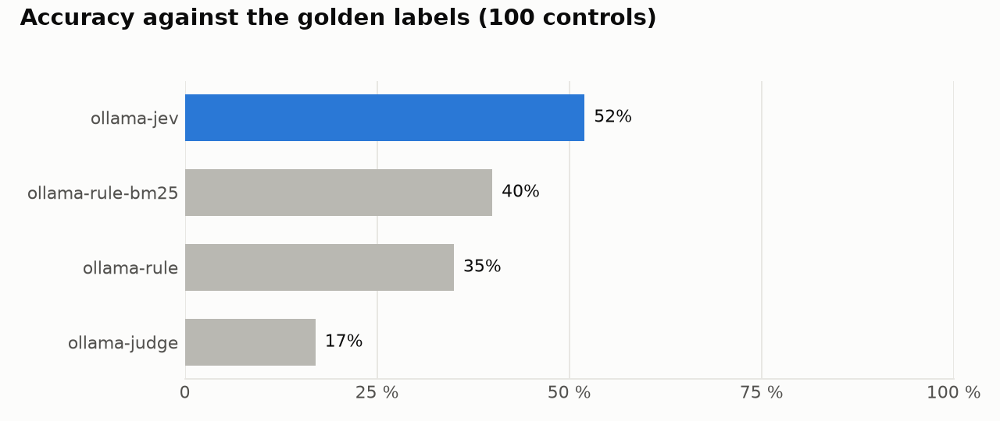
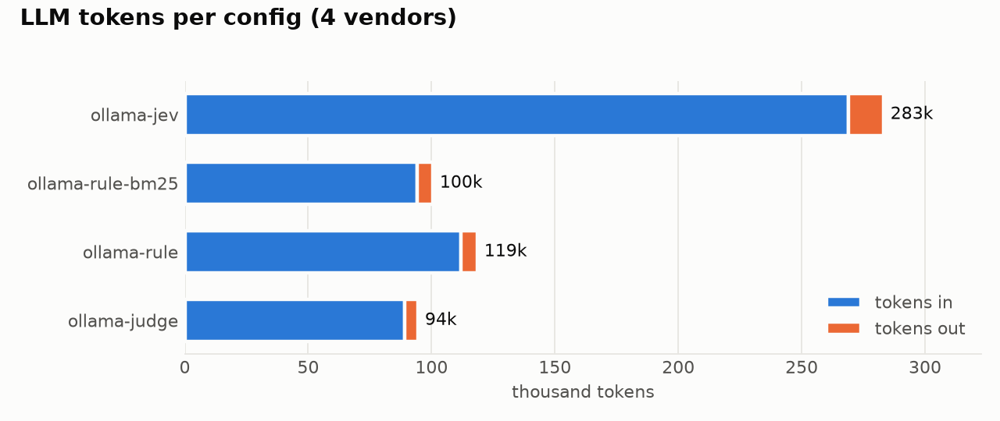
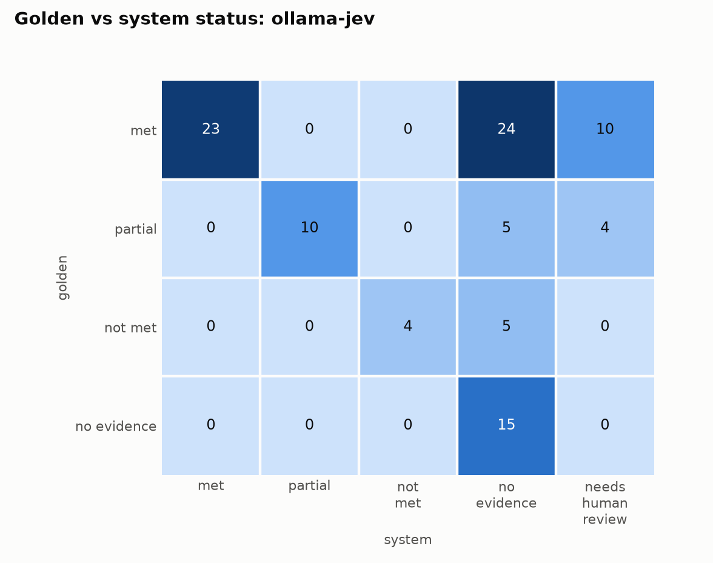

# Evaluation

This page reports how well VendorGuard AI reproduces known control statuses on four synthetic vendors.
Read the limits first. They change what the numbers mean.

## Limits of this evaluation

1. **All documents are synthetic.** They are generated from specs with a known vocabulary
   (`data/samples/specs/*.yaml`). There are 4 vendors with 25 controls each, so 100 controls per config.
   The results do not transfer to real vendor documents.
2. **`keyword-baseline` is not a model result.** It uses the mock LLM and scores 1.00 only because it matches
   the generator's own vocabulary. It checks that the pipeline is consistent. It is left out of the charts.
3. **One model size only.** Every real run uses `qwen2.5:3b` on a CPU-only Intel Mac. No hosted LLM was
   measured. The weak results are limits of this small model. They are not a verdict on LLM judges or on the
   approach.
4. **Real-model runs are not repeatable.** See [Determinism](#determinism). Each accuracy figure below is one
   noisy sample. No confidence intervals were computed, so small gaps between configs mean little.
5. **Risk scores of these runs are not facts about the vendors.** Wrong `no_evidence` findings raise the score.
   Low-risk vendors look risky in the real-model runs (see [Risk scores](#risk-scores)).
6. **Wall time differs on every run.** It also depends on the machine (CPU-only Intel Mac).

## Method

- **Samples.** `make sample` generates four vendors: `brightdock`, `nimbara-hr`, `nimbara-hr-y2` and
  `quillfield`. Each has a PDF and golden labels in `data/golden/`. A golden label is one of `met`, `partial`,
  `not_met` or `no_evidence` per control.
- **Matrix.** `vg eval` runs each config in `eval.configs` (`config/settings.yaml`) on every sample, with the
  same controls, prompts and settings. The model cache is off (`eval.cache_enabled: false`), so tokens and times
  are real.
- **Compared status.** The system's own `status` is compared with the golden label. Analyst overrides are not
  part of an evaluation.
- **Configs.**

| Config | LLM | Decider | Embeddings |
|---|---|---|---|
| `keyword-baseline` | mock | rule | none |
| `ollama-rule` | qwen2.5:3b | rule | nomic-embed-text (hybrid retrieval) |
| `ollama-rule-bm25` | qwen2.5:3b | rule | none (BM25 only) |
| `ollama-judge` | qwen2.5:3b | LLM judge | nomic-embed-text |
| `ollama-jev` | qwen2.5:3b | Jev (`jev-1.14.0`, TypeSafe System One API) | nomic-embed-text |

The LLM extracts quotes. Python derives the status from the quotes (ADR-017). The decider only runs the triage
and verify gates. Jev is a hosted, paid, alpha-stage service (ADR-016, ADR-020).

## Metric definitions

| Metric | Meaning |
|---|---|
| Accuracy | Share of controls where the system status equals the golden label. `needs_human_review` is never right, so it always counts as wrong. |
| Macro-F1 | Mean F1 over the golden classes that occur in the golden labels or in the system's answers (a class in neither is left out), computed from the confusion matrix pooled over the vendors. `needs_human_review` is a prediction only. It is not an F1 class, but it lowers recall. |
| Human-review rate | Share of controls that ended as `needs_human_review`. |
| Triage skip rate | Share of controls where triage said "not addressed" with enough confidence that the run never reached the citation gate. |
| Citation validity | Per vendor: share of checked citations that are valid (a relocated quote counts as valid); the table shows the mean over the vendors. |
| LLM calls, tokens | Calls to the language model and their tokens, summed over the four vendors. Calls of the `llm_judge` decider are LLM calls and are included. |
| Jev decider calls | Calls to the Jev decider. They are not LLM calls. |
| Cost USD | Paid usage. Only Jev has a price here. |
| Wall time | Seconds for the config over four vendors. |

## Results per config

Four vendors, 25 controls each. Source: `docs/evaluation/results.json`.

| Config | Accuracy | Macro-F1 | Human review | Triage skip | Citation validity | LLM calls | Tokens in | Tokens out | Jev calls | Cost USD | Wall time |
|---|---|---|---|---|---|---|---|---|---|---|---|
| `keyword-baseline` (mock) | 1.00 | 1.00 | 0 % | 15 % | 1.00 | 0 | 0 | 0 | 0 | 0 | 1.1 s |
| `ollama-jev` | **0.52** | **0.59** | 14 % | 14 % | 1.00 | 113 | 268,813 | 14,326 | 198 | 0.0061 | 2,249 s (37 min) |
| `ollama-rule-bm25` | 0.40 | 0.40 | 0 % | 15 % | 1.00 | 95 | 94,268 | 6,226 | 0 | 0 | 1,385 s (23 min) |
| `ollama-rule` | 0.35 | 0.30 | 1 % | 0 % | 1.00 | 110 | 111,945 | 6,568 | 0 | 0 | 1,625 s (27 min) |
| `ollama-judge` | 0.17 | 0.08 | 1 % | 97 % | 1.00 | 116 | 89,028 | 5,453 | 0 | 0 | 1,452 s (24 min) |

The inherent-risk tier was correct for all four vendors in every config.

## Accuracy per vendor

| Config | brightdock | nimbara-hr | nimbara-hr-y2 | quillfield |
|---|---|---|---|---|
| `keyword-baseline` (mock) | 1.00 | 1.00 | 1.00 | 1.00 |
| `ollama-jev` | 0.48 | 0.52 | 0.56 | 0.52 |
| `ollama-rule-bm25` | 0.48 | 0.40 | 0.20 | 0.52 |
| `ollama-rule` | 0.40 | 0.36 | 0.24 | 0.40 |
| `ollama-judge` | 0.32 | 0.12 | 0.08 | 0.16 |

Each vendor has 25 controls, so one control is 0.04. The rule configs are weakest on `nimbara-hr-y2`.

## Charts

Charts exclude the mock baseline. Regenerate them with `vg charts`.







The confusion matrix shows `ollama-jev`, the best config by accuracy.

## What went wrong, and why

- **Most errors are a false `no_evidence`.** The 3B model often returns no quote. Python then derives
  `no_evidence`, even when the document covers the control.
- **The LLM judge skipped 97 % of controls.** The 3B judge answered "not addressed" almost every time, so most
  controls never reached the mapper. This is a limit of the small model. It says nothing about judges in
  general.
- **Real embeddings gave no measurable gain.** `ollama-rule` (nomic-embed-text) scored 0.35 against 0.40 for
  BM25 alone, a gap inside the noise of a single run. Triage never skipped a control with embeddings (0 %); an
  earlier single run (task 6.7) also showed the retrieval floor always being met with embeddings, so the likely
  reason is that a cosine score is never low. That means more calls and no gain on these documents.
- **Jev is best, and it costs human review.** `ollama-jev` reached 0.52 accuracy and 0.59 macro-F1. 14 % of its
  controls went to human review. The cause of its lead was not isolated: a small smoke test (4 controls) showed
  its verify gate rejecting drafts that the rule decider accepted, which may explain part of it, but the gain is
  larger than the human-review share and Jev's own run-to-run variation was not measured. This is a trade, not a free gain. Jev is hosted, paid (about $0.006 for the 198 calls) and alpha
  stage. This is one small sample.

## Risk scores

The scores of the real-model runs are inflated by false `no_evidence` findings. The mock baseline, which
matches the golden labels, scores `brightdock` 43.9, `nimbara-hr` 18.2, `nimbara-hr-y2` 11.8 and `quillfield`
30.8. In the real-model runs the scores range from 45.2 to 93.3, and `ollama-judge` gives 91.7 to `nimbara-hr`
and 93.3 to `nimbara-hr-y2`. Do not read these scores as facts about the vendors.

## Determinism

Source: `docs/evaluation/determinism.json`. Config `ollama-rule-bm25`, cache off, 2 repeats per vendor.

| Vendor | Findings identical (of 25) | Result hash identical |
|---|---|---|
| brightdock | 17 | no |
| nimbara-hr | 11 | no |
| nimbara-hr-y2 | 11 | no |
| quillfield | 13 | no |
| **All** | **52 %** | **0 %** |

A real Ollama run was not repeatable here, even at temperature 0 with a fixed seed. Only two repeats were run, and an earlier test (task 4.2) found that the first call after a model load can differ from later calls, so the first repeat may have been a cold start and the 52 % mixes that effect with ordinary variation. More repeats, with a warm-up run first, would separate them. A finding counts as identical only
when its whole JSON (status, quotes, trace, rationale) matches. Determinism was measured only for
`ollama-rule-bm25`, not for `ollama-jev`.

Exactness comes from the record and replay cache. Replaying the committed cassettes gives 100 % identical
results (`tests/integration/test_determinism.py`). The mock baseline is also 100 % identical.

## Conclusions

- On synthetic documents, a 3B local model with the rule decider reaches 0.35 to 0.40 accuracy. That is not
  enough to rely on, which is why the product routes doubtful findings to a person.
- The best result (Jev, 0.52 accuracy) has an unisolated cause, and comes at the price of 14 % human review and
  a paid hosted service.
- Whether a larger or hosted model closes the gap is not measured here.
- The comparison between deciders and between BM25 and embeddings rests on one run each. Treat gaps of a few
  points as noise.

## Reproduce

```bash
make sample                          # generate the synthetic vendors and golden labels
ollama pull qwen2.5:3b               # local model
ollama pull nomic-embed-text         # embeddings
uv run vg eval                       # whole matrix, writes docs/evaluation/results.json
uv run vg eval --configs keyword-baseline,ollama-rule-bm25   # a subset, merged into results.json
uv run vg determinism --config ollama-rule-bm25              # writes docs/evaluation/determinism.json
uv run vg charts                     # regenerate the PNG charts
```

`ollama-jev` needs `VG_DECISION__JEV__API_KEY` in `.env` (see `.env.example`). Without a key the config is
skipped. The full matrix took about 2 hours on a CPU-only Intel Mac (6,711 s of recorded wall time). Tokens and times differ slightly on every
run.
