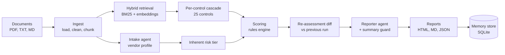
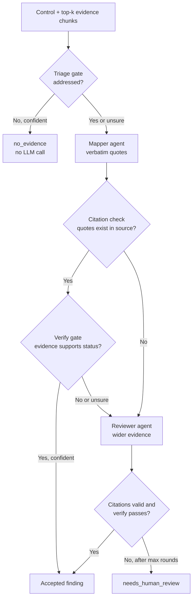

# Architecture

LLMs extract and draft. Python decides the flow and computes the scores (ADR-001, see [Decisions](DECISIONS.md)).

## Pipeline

One module, `pipeline/orchestrator.py`, wires the stages together. Both the CLI and the API call it.

| Stage | What happens |
|---|---|
| Ingest | Load (type, size, page and encoding checks), clean (Unicode normalisation, repeated headers removed, de-hyphenation), chunk (sentence-aware, with page numbers) |
| Retrieve | One retrieval per control: BM25 plus cosine similarity on embeddings, combined with weights from settings. If the embedder fails, all controls fall back to BM25 only and one audit event records it |
| Intake | One LLM call extracts services, data categories, hosting, certifications and subprocessors. Python turns the data categories into an inherent risk tier (low, medium, high) |
| Cascade | Per control, see below. Controls run on a thread pool and results are sorted by control ID |
| Scoring | Exact decimal arithmetic. Weights, points per status, bands and the inherent-risk multiplier come from settings |
| Diff | If the vendor has a stored earlier run, new gaps, resolved gaps and the score change are computed |
| Report | The Reporter writes a short summary from structured facts; HTML, Markdown and JSON reports are rendered |

## The per-control cascade

The model extracts quotes. Python derives the status from the quotes (ADR-017), reading the full source
sentence of each quote so that a clause cut out of "We do not encrypt ..." still reads as `not_met`.
A finding is accepted only if its quotes pass the citation check and the verify gate is confident.
The Reviewer runs at most `pipeline.max_review_rounds` rounds (1 in the shipped settings). A control
still in doubt becomes `needs_human_review`. Each gate decision is written to the audit log with its reason.

## Agents

| Agent | Job | Output |
|---|---|---|
| Intake | Extract vendor facts from the first chunks | `VendorProfile` |
| Mapper | Quote evidence for one control; status is derived from the quotes | `DraftFinding` |
| Reviewer | Second look at flagged findings, with extra evidence | revised `DraftFinding` |
| Reporter | Executive summary from structured facts only | text, checked by the summary guard |
| Ask | Answer questions about a vendor's stored history | `Answer` with cited run and control IDs |

Every agent shares one base class. It renders a versioned prompt from `prompts/`, calls the LLM with a JSON
schema, validates the output with Pydantic and writes exactly one audit event per call.

## Decision layer

Two gates (triage and verify) use a pluggable decider. Choose it with `decision.provider`.

| Decider | What it is |
|---|---|
| `rule` (default) | Keyword and retrieval-score rules; no model call, $0 |
| `llm_judge` | An LLM answers the gate question with a label and a confidence |
| `jev` | A hosted decision model reached through an API (opt-in, paid, needs a key) |
| `mock` | The rules under another name, for tests |

If the `jev` decider is unavailable, or an LLM judge fails, a fallback wrapper switches to the rule decider
and writes an audit event, so a run does not stop. The thresholds `triage_threshold` and `verify_threshold`
are applied by the cascade, not by the decider. See ADR-004 and ADR-016 in [Decisions](DECISIONS.md).

## Determinism

| Level | Mechanism |
|---|---|
| Pure code | Rules engine, citation checks, diff and rendering use stable sorting (ties broken by ID) and canonical JSON |
| Cache | Every model call goes through a record/replay cache keyed by provider, model, purpose, rendered messages, schema, generation parameters and hints |
| Model settings | Temperature 0, fixed seed, JSON-schema output, Pydantic validation, bounded repair attempts |
| Run identity | `run_id` is a hash of the vendor, the input document hashes and the config fingerprint (`pipeline.deterministic_run_ids`). The same documents with the same settings give the same ID |

Cache modes are `off`, `read_write` and `read_only`. In `read_only` (replay) a miss raises an error that
tells you to re-record, and the model is never called. CI replays committed cassettes this way.

A real model is not repeatable on its own. In the measured runs, with the cache off, two identical runs
did not give identical results; see [Evaluation](EVALUATION.md) for the numbers. Exact repeatability comes
from the cache.

## Untrusted documents

Vendor documents are untrusted input.

- Prompts wrap document text in `<document>` tags and tell the model to ignore instructions inside them.
- Every quote the model returns is checked against the source chunk text after Unicode normalisation. An
  exact match passes. A near match above `citation_min_similarity` is replaced by the source text. Anything
  else is invalid.
- A finding with no valid quote is not accepted as `met` or `partial` (`verification.require_citation_for`).
- The summary guard rejects an executive summary that contains a number or control ID not found in the facts,
  and the template summary is used instead. The Ask guard does the same for run and control IDs.
- One sample vendor contains an injected instruction as a regression test.

## Providers and the factory

Code depends on Protocols in `interfaces/` (LLM client, embedder, decider, cache backend, memory store, memory
assistant). Concrete classes are created only in `factory.py`, through registries keyed by the names that
appear in `config/settings.yaml`.

| Kind | Registered implementations |
|---|---|
| LLM (`llm.provider`) | `ollama`, `openai`, `groq`, `openai_compat`, `mock` |
| Embeddings (`embeddings.provider`) | `ollama`, `none` |
| Decider (`decision.provider`) | `rule`, `llm_judge`, `jev`, `mock` |
| Cache (`cache.backend`) | `sqlite`, `jsonl` |
| Memory (`memory.provider`) | `sqlite` |

The LLM is nested as a cache around a budget guard around the client, so only real calls are checked and
paid, and replays still work after the budget is spent. The budget guard enforces `cost.max_llm_calls_per_run`
and `cost.max_usd_per_run`. Local models run through Ollama and cost $0.

## Memory and re-assessment

The SQLite memory store keeps each finished result (canonical JSON as the source of truth), vendors, findings
and overrides. When a vendor already has a stored run, the orchestrator compares the new findings with the
newest earlier run and records new gaps, resolved gaps, every status change and the score delta. The diff
appears in the reports and in the `result.json`. `vg ask` and `POST /v1/vendors/{id}/ask` answer from this
history. The Ask agent is told only facts; a guard rejects answers that cite IDs that do not exist or that
write IDs without citing them, and a fixed template answer is used instead (ADR-018).

Letta, the stateful-agent memory named in the early design, is not built (ADR-019).

## Analyst override

An override replaces a control's effective status and keeps the system's own status in the finding. The score is
recomputed, the summary is rebuilt from the template (no model call, so the numbers stay true) and the reports
are rewritten. The override reason and analyst go in the result; the audit log records an
`analyst_override` event with hashes only.

## Audit log and run manifest

Each run writes a folder with these files (see [CLI](cli.md#run-folder)):

| File | Content |
|---|---|
| `audit.jsonl` | One JSON line per event, in order: stage, actor, SHA-256 of input and output, tokens, cost, latency, cached flag, control ID and decision. Texts of documents are not stored |
| `manifest.json` | Status, config fingerprint, prompt hashes, providers and models, input document hashes, git SHA, result hash |
| `result.json` | The full `AssessmentResult` |

The result hash covers the result without timestamps, cost and manifest path, so two runs of the same inputs
can be compared. Logs redact every configured secret. The API exposes counters and timings at `/metrics`
(Prometheus text format).
